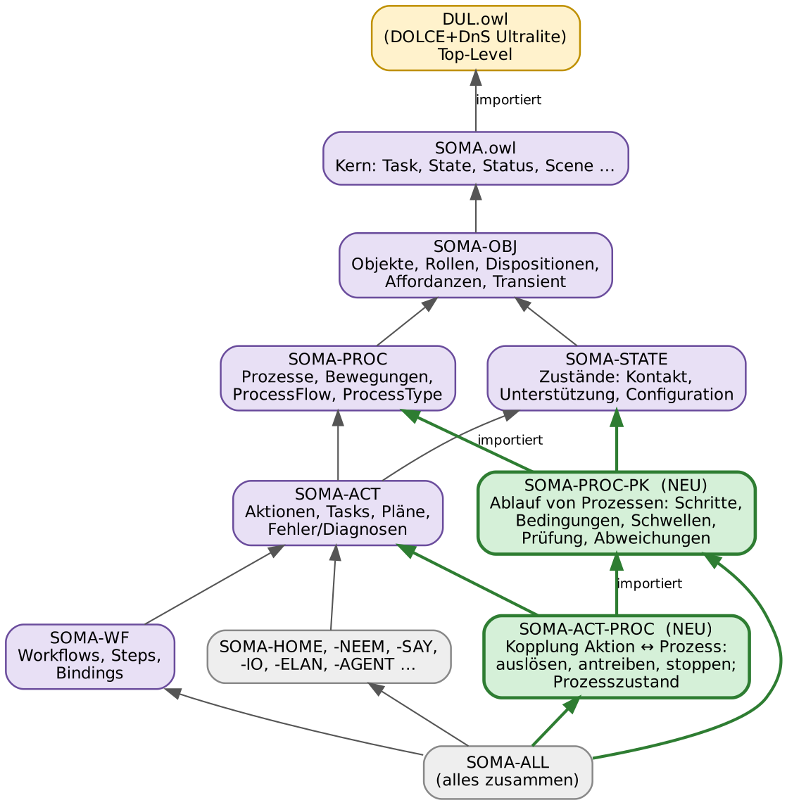
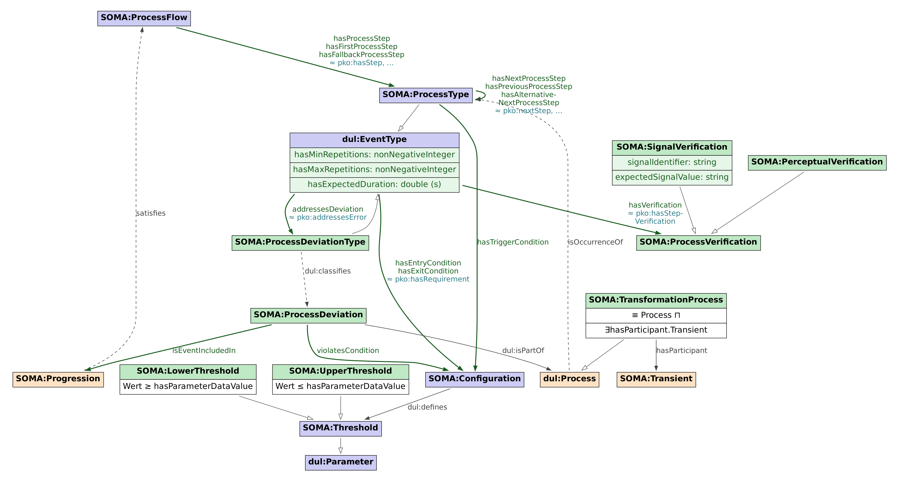
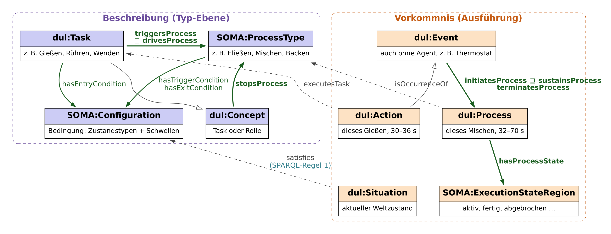
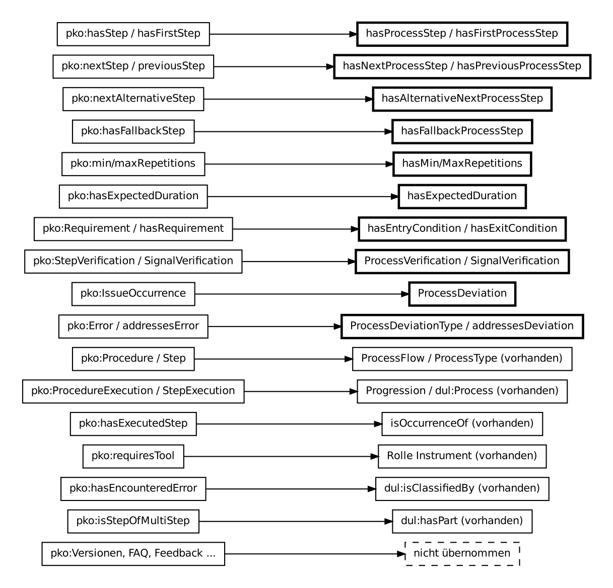

# SOMA 3.0 – Aktionen und Prozesse für Roboter

**Erweiterung der Ontologie SOMA um den Ablauf von Prozessen und um die Kopplung von Aktionen und Prozessen**

Firaz Kilic · Universität Bremen, Institute for Artificial Intelligence (IAI) · 2026

*„SOMA 3.0“ ist ein Arbeitstitel. Grundlage ist SOMA 2.2.0 aus [ease-crc/soma](https://github.com/ease-crc/soma)
(Commit `5d27187`). Diese Dokumentation beschreibt den Ausgangsstand von SOMA und jede Änderung mit Begründung.*

---

## Ausgangssituation: Was SOMA heute hat

### DUL in fünf Begriffen

SOMA baut auf **DUL** auf (DOLCE+DnS Ultralite), einer kleinen Top-Level-Ontologie. Für das Verständnis der
Erweiterung reichen fünf Ideen:

| Idee | Bedeutung | Beispiel |
|---|---|---|
| `dul:Event` vs. `dul:Object` | Alles, was *geschieht*, ist ein Ereignis; alles, was *ist*, ist ein Objekt. Beide Klassen sind disjunkt. | das Gießen um 30 s · die Pfanne |
| `dul:Action` und `dul:Process` | Zwei Arten von Ereignissen: eine Aktion hat einen handelnden Agenten und führt eine Aufgabe aus; ein Prozess braucht keinen. In DUL sind beide **nicht** disjunkt. | Gießen · Backen |
| Beschreibung und Situation (**DnS**) | Eine `dul:Description` legt fest, wie etwas sein soll (Plan, Ablauf, Bedingung); eine `dul:Situation` ist ein tatsächlicher Zustand der Welt, der eine Beschreibung erfüllen kann (`dul:satisfies`). | Ablaufbeschreibung „Backen“ · dieser konkrete Backvorgang |
| Begriff klassifiziert Ding | Ein `dul:Concept` (Aufgabe, Rolle, Ereignistyp, Parameter) *klassifiziert* ein konkretes Ding (`dul:classifies`), ohne dass das Ding zur Unterklasse wird. | die Aufgabe „Gießen“ klassifiziert dieses Gießen |
| Parameter und Region | Ein `dul:Parameter` begrenzt die Werte, die ein Ding haben darf; Werte liegen in einer `dul:Region` (z. B. einem Temperaturbereich). | „mindestens 160 °C“ |

Daraus ergibt sich in SOMA durchgängig eine **Zweiteilung**: eine *beschreibende* Ebene (Aufgaben, Prozesstypen,
Abläufe, Bedingungen – also Begriffe und Beschreibungen) und eine *physische* Ebene (konkrete Aktionen, Prozesse,
Zustände, Objekte). Die Erweiterung hält sich an diese Zweiteilung.

### Aufbau von SOMA

SOMA (Socio-physical Model of Activities) [2] ist die Ontologie des IAI Bremen für Alltagsaktivitäten von Robotern und
wird in KnowRob und CRAM verwendet. Version 2.2.0 besteht aus diesen Dateien:

| Modul | Inhalt | importiert |
|---|---|---|
| `DUL.owl` | DOLCE+DnS Ultralite | – |
| `SOMA.owl` | Kern: Zustände, Rollen, Status, Szenen, Zeitrelationen (`before`, `during` …), Zeitpunkte (`hasEventBegin/End`) | DUL |
| `SOMA-OBJ.owl` | Objekte, Dispositionen, Affordanzen, Qualitäten und Regionen, `Transient` | SOMA |
| `SOMA-PROC.owl` | **Prozesse:** `ProcessType` mit Taxonomie, `ProcessFlow`, `Progression`, Bewegungen | SOMA, SOMA-OBJ |
| `SOMA-STATE.owl` | **Zustände:** `StateType`, `Configuration`, Kontakt-, Halte-, Enthaltenseins-Zustände | SOMA, SOMA-OBJ |
| `SOMA-ACT.owl` | **Aktionen:** Aufgaben-Taxonomie (`PhysicalTask` …), Ausführungszustand, Diagnosen, Kausalität (`causes`) | DUL, SOMA, SOMA-PROC, SOMA-STATE |
| `SOMA-WF.owl` | Arbeitsabläufe aus Aufgaben (Workflows, Schritte, Bindungen) | SOMA, SOMA-ACT, SOMA-STATE |
| `SOMA-IO.owl`, `SOMA-SAY.owl`, `SOMA-AGENT.owl`, `SOMA-NEEM.owl` | Information, Sprache, Agenten, Episoden (NEEMs) | – |
| `SOMA-ALL.owl` | bindet alle obigen Module zusammen | alle obigen |
| `SOMA-HOME.owl` | Haushaltsbegriffe, baut auf SOMA-ALL auf | SOMA-ALL |
| `SOMA-ELAN.owl`, `SOMA-Allen.owl`, `USD.owl` | Zusatzdateien, **nicht** in SOMA-ALL eingebunden | – |

**Größe von SOMA-ALL** (ohne die Erweiterung): 495 Klassen, 202 Object Properties, 36 Data Properties und 10 benannte
Individuen im SOMA-Namensraum, dazu 78 Klassen und 117 Properties aus DUL.

**Die wichtigste Designregel** steht im Kopf von `SOMA-PROC.owl`: *SOMA-PROC should not import SOMA-ACT … the process
is more fundamental than the action – an action can even be regarded as a process as long as the agentive nature of
its cause is not relevant.* Aktionen bauen auf Prozessen auf, nicht umgekehrt.

### Prozesse in SOMA

SOMA-PROC hat zwei Seiten:

- **Beschreibend:** `SOMA:ProcessType` (ein `dul:EventType`, der Prozesse klassifiziert) mit einer Taxonomie von
  Prozessarten. `SOMA:ProcessFlow` ist „eine Beschreibung, die einen Prozess strukturiert“; er definiert Prozesstypen
  über `SOMA:definesProcess`. Einzige Unterklasse: `MotionDescription`.
- **Physisch:** konkrete Prozesse sind `dul:Process` (Unterklassen nur `ChemicalProcess` und
  `PhysicsProcess` → `MotionProcess`). Ein konkreter Prozess gehört über `SOMA:isOccurrenceOf` zu seinem Typ.
  `SOMA:Progression` ist eine Situation, die einen `ProcessFlow` erfüllt (`dul:satisfies`).
- **Zwischenprodukte:** `SOMA:Transient` ist ein Objekt, das während eines Prozesses weder die Eingabe noch schon das
  Ergebnis ist; `transitionsFrom` / `transitionsTo` verbinden es mit beiden.
- **Rollen:** `SOMA:hasProcessType` verbindet eine Rolle mit einem Prozesstyp (z. B. ein Katalysator).

So sieht die Taxonomie der Prozesstypen im Original aus (Protégé-Ansicht, ▸ = hat weitere Unterklassen):

<pre>
SOMA:ProcessType
├─ SOMA:Alteration
│  ├─ SOMA:Deformation
│  └─ SOMA:PhaseTransition  ▸
├─ SOMA:Collision
├─ SOMA:Creation
├─ SOMA:Destruction
├─ SOMA:ForceInteraction
│  ├─ SOMA:AlterativeInteraction
│  └─ SOMA:PreservativeInteraction
└─ SOMA:Motion
   ├─ SOMA:BodyMovement  ▸
   ├─ SOMA:DirectedMotion  ▸
   ├─ SOMA:FluidFlow
   └─ SOMA:UndirectedMotion
</pre>

Die Prozessarten sind fast ausschließlich **Bewegungen** (Fortbewegung, Greifen, Kopfdrehen …) und
physikalische Veränderungen (Verformung, Sieden). Ein `ProcessFlow` sagt nur, *welche* Prozesstypen er definiert –
nicht in welcher Reihenfolge, wie oft, wie lange, unter welchen Bedingungen und mit welchem Ergebnis.

### Zustände in SOMA

SOMA-STATE beschreibt Zustände als Ereignisse, die sich nicht verändern (`SOMA:State`, „stative and homeomeric
events“). Ein `SOMA:StateType` klassifiziert sie (z. B. `ContactState`, `ContainmentState` in `FunctionalControl`).
Eine **`SOMA:Configuration`** ist „eine Beschreibung eines Zustands“ und beschreibt einen `StateType`
(`dul:describes`). Im Kern-SOMA gibt es außerdem **`SOMA:Threshold`** („a role played by a parameter which indicates
some value that, when crossed, triggers some condition“) – aber ohne Unterklassen, ohne Richtung (oben/unten) und ohne
Verwendung in einem Muster.

### Aktionen in SOMA

SOMA-ACT beschreibt Aktionen (`dul:Action`) und eine große Taxonomie von Aufgaben (`dul:Task` → `PhysicalTask` →
`Actuating`, `Manipulating` …). Für diese Arbeit wichtig:

- Gießen, Schneiden, Rühren, Wenden, Halten sind Aufgaben (`SOMA:Pouring`, `Cutting`, `Stirring`, `Flipping`,
  `Holding`). **Mischen gibt es nur als Aufgabe** (`SOMA:Mixing`: „A task by which an Agent combines several
  entities“), nicht als Prozess, der beim Gießen der zweiten Zutat beginnt und erst nach dem Rühren endet.
- **Ausführungszustand:** `SOMA:hasExecutionState` verbindet eine Aktion mit einem von sechs Werten
  (`ExecutionState_Active`, `_Cancelled`, `_Failed`, `_Paused`, `_Pending`, `_Succeeded`; Klasse
  `ExecutionStateRegion`). Die Domain ist `dul:Action` – **für Prozesse gibt es keinen Zustand.**
- **Kausalität:** `SOMA:causes` (transitiv, ⊑ `SOMA:affects` ⊑ `dul:precedes`) und `SOMA:directlyCauses` zwischen
  Ereignissen. Sie sagen nur „A verursacht B“, nicht ob B *gestartet*, *angetrieben* oder *beendet* wurde.
- Außerdem gibt es `SOMA:causesTransition` (ein Ereignis bewirkt einen Situationsübergang).

### Zeit in SOMA

Ereignisse haben Zeitpunkte (`SOMA:hasEventBegin`, `hasEventEnd`, Sekunden als `xsd:double`). `SOMA.owl` enthält die
**Allen-Relationen** als Vokabular (`before`, `after`, `meets`, `metBy`, `overlappedBy`, `during`, `contains`,
`starts`, `startedBy`, `finishes`, `finishedBy`, `simultaneous`) mit einem Teil ihrer Eigenschaften. Weitere Axiome
stehen in `SOMA-Allen.owl`, das laut eigenem Kommentar nicht eingebunden ist, weil es OWL DL sprengt. Aus Zeitpunkten
ableiten kann ein OWL-Reasoner diese Relationen ohnehin nicht, weil OWL keine Zahlen vergleicht.

### Was fehlt

Das SOMA-Paper [2] sagt ausdrücklich: *„An action may cause processes to be started or stopped, and states to be
changed.“* Im Modell ist das nicht abgebildet. Zusammengefasst:

| Frage, die ein Roboter beantworten muss | Was SOMA dafür hat | Lücke |
|---|---|---|
| Aus welchen Schritten besteht ein Prozess, in welcher Reihenfolge? | `ProcessFlow` + `definesProcess` | keine Schritte, keine Reihenfolge, keine Verzweigung |
| Wie oft, wie lange? | – | keine Wiederholungen, keine erwartete Dauer |
| Wann kann ein Schritt beginnen, wann ist er fertig? | `Configuration` (Zustandsbeschreibung) | keine Verbindung zwischen Schritt und Bedingung |
| „Mindestens 160 °C“ | `Threshold` | keine Richtung, kein Muster |
| Wie prüft man den Erfolg? | – | fehlt |
| Was, wenn etwas schiefgeht? | Diagnosen nur für Aktionen (SOMA-ACT) | keine Abweichung eines Prozesses, kein Fallback |
| Welche Aufgabe startet / stoppt welchen Prozess? | – | fehlt |
| Läuft der Prozess ohne den Roboter weiter? | – | fehlt |
| Startet ein Prozess von selbst, wenn ein Zustand eintritt? | – | fehlt |
| Welche konkrete Aktion hat welchen konkreten Prozess gestartet / beendet? | nur allgemein `causes` | keine Unterscheidung starten / antreiben / beenden |
| In welchem Zustand ist ein Prozess (läuft, fertig, abgebrochen)? | `hasExecutionState` nur für Aktionen | fehlt für Prozesse |
| Welche Prozesse laufen *jetzt*, welche müssen starten oder enden? | – | OWL kann das nicht entscheiden (Zeit, Zahlen, Verneinung) |

### Woraus die Erweiterung schöpft

**Procedural Knowledge Ontology (PKO) [1].** Beschreibt industrielle Verfahren (Cefriel, EU-Projekt PERKS), aufbauend
auf PROV-O und P-Plan. Ihre Stärke ist eine genaue Schrittstruktur: Reihenfolge (`nextStep`), Alternativen
(`nextAlternativeStep`), Fallback (`hasFallbackStep`), Wiederholungen und Dauer, Voraussetzungen (`Requirement`),
Prüfung (`StepVerification`, `SignalVerification`), Probleme (`IssueOccurrence`, `Error`). Etwa die Hälfte der PKO
betrifft die Organisation von Verfahren für Menschen in Firmen (Versionen, Vorlagen, FAQ, Feedback) und gehört nicht
in eine Roboter-Ontologie. Wie SOMA trennt die PKO Beschreibung (`Procedure`, `Step`) und Ausführung
(`ProcedureExecution`, `StepExecution`); deshalb lässt sie sich Ebene für Ebene übertragen.

| Ebene | PKO | SOMA |
|---|---|---|
| beschreibend | `pko:Procedure`, `pplan:Step` | `SOMA:ProcessFlow`, `SOMA:ProcessType` |
| ausgeführt | `pko:ProcedureExecution`, `pko:StepExecution` | `SOMA:Progression`, `dul:Process` |

**Kümpel et al. 2024 [4].** Zeigen am Beispiel Pfannkuchen, dass ein Roboter wissen muss, welche Aufgabe welchen
Prozess auslöst (*triggers_process*) und welche ihn stoppt (*stops_process*), dass Prozesse auch durch einen Zustand
beginnen (Teig in heißer Pfanne) und dass dabei Zwischenprodukte (Transients) mit Ein- und Austrittsbedingungen
entstehen.

**PDDL+ [5].** Die Planungssprache unterscheidet drei Dinge: **Aktionen** (der Agent entscheidet), **Prozesse**
(laufen, solange ihre Bedingung gilt) und **Ereignisse** (treten von selbst ein, sobald ihre Bedingung gilt). Aktionen
und Ereignisse starten und stoppen Prozesse. Ein Prozess ist dort aber kein Ding, auf das man verweisen kann.

**Event Calculus [6].** Ereignisse *beginnen* (initiates) und *beenden* (terminates) etwas, das dazwischen andauert.

---

## Die Lösung im Überblick

<p align="center"></p>

- **`SOMA-PROC-PK`** steht neben SOMA-PROC und importiert SOMA-PROC und SOMA-STATE (für `Configuration`), aber
  **nicht SOMA-ACT** – die Designregel bleibt erhalten. Es beschreibt den Ablauf eines Prozesses.
- **`SOMA-ACT-PROC`** liegt über SOMA-ACT und SOMA-PROC-PK, weil es Aktionen und Prozesse verbindet. Es darf deshalb
  Begriffe aus SOMA-ACT benutzen (`ExecutionStateRegion`, `directlyCauses`).
- Beide Module werden von `SOMA-ALL.owl` importiert und stehen im Katalog `catalog-v001.xml` (je eine Zeile).
- Alle neuen Begriffe liegen im SOMA-Namensraum `http://www.ease-crc.org/ont/SOMA.owl#`, damit sie sich wie
  SOMA-Begriffe verhalten; die Module sind als Vorschlag für SOMA gedacht.

**Ablauf eines Prozesses (Modul 1).** Grün = neu, ≈ = Vorbild in der PKO, offener Pfeil = Unterklasse.

<p align="center"></p>

**Kopplung von Aktionen und Prozessen (Modul 2).** Die Kopplung gibt es auf zwei Ebenen, wie überall in SOMA:
zwischen Beschreibungen („die Aufgabe Gießen startet den Prozesstyp Mischen“) und zwischen Vorkommnissen („das
Gießen um 30 s hat das Mischen um 32 s gestartet“).

<p align="center"></p>

| Kopplung | Beispiel | zwischen Typen (Task → ProcessType) | zwischen Vorkommnissen (Event → Process) |
|---|---|---|---|
| Aktion **startet** einen Prozess, der danach allein weiterläuft | Teig in heiße Pfanne → Backen | `triggersProcess` | `initiatesProcess` |
| Aktion **treibt** einen Prozess **an**, er läuft nur so lange wie sie | Gießen → Fließen | `drivesProcess` ⊑ `triggersProcess` | `sustainsProcess` ⊑ `initiatesProcess` |
| Aktion oder Rolle **beendet** einen Prozess | Rühren fertig → Mischen endet | `stopsProcess` | `terminatesProcess` |
| Prozess startet **ohne Aktion**, weil ein Zustand eintritt | heiße Pfanne + Teig → Backen | `hasTriggerCondition` (Modul 1) | Auslöser ist ein `dul:Event`, das keine Aktion ist |
| Prozess **ermöglicht** eine Aktion | Unterseite goldbraun → Wenden möglich | Endbedingung des Prozesstyps = Startbedingung der Aufgabe | über die gemeinsame Bedingung abfragbar |
| Aktion **ohne** eigenen Prozess | Schneiden | keine Kopplung | – |

**Was OWL leistet und was nicht.** OWL legt fest, *was* die Begriffe bedeuten, und ein Reasoner zieht die logischen
Folgerungen (Gegenrichtungen, Oberbegriffe, Klassifikation). Ob eine Bedingung *jetzt* erfüllt ist, welcher Prozess
*jetzt* läuft oder enden muss, hängt von Zahlen, Zeit und dem Fehlen von Aussagen ab – das kann OWL nicht entscheiden.
Dafür braucht eine Anwendung zusätzlich Abfragen (z. B. SPARQL) über den aktuellen Weltzustand; sie sind nicht Teil
dieses Repositorys.

---

## Gegenüberstellung in der Protégé-Ansicht

Die folgenden Bäume zeigen links das Original-SOMA und rechts SOMA 3.0, so wie sie in Protégé im Reiter *Entities*
erscheinen (asserted hierarchy, Anzeige über **View → Render by prefixed name**). Sie sind direkt aus den OWL-Dateien
erzeugt. Damit die Bäume lesbar bleiben, sind nur die Äste aufgeklappt, in denen sich etwas ändert;
**▸** heißt „hat weitere Unterbegriffe“, **… n weitere** fasst unveränderte Geschwister zusammen.
**🟩 fett** = neu in SOMA 3.0. Bestehende Begriffe werden an keiner Stelle verändert; alle Änderungen sind neue
Begriffe unter vorhandenen.

### Klassen

**Ereignisse (`dul:Event`).** Neu: der definierte `TransformationProcess` unter `dul:Process` und die
`ProcessDeviation` als eigenes Ereignis.

<table>
<tr><th>Original-SOMA 2.2.0</th><th>SOMA 3.0 (🟩 = neu)</th></tr>
<tr><td valign="top">
<pre>
dul:Event
├─ SOMA:Accident
├─ dul:Action
│  ├─ SOMA:CommunicationAction  ▸
│  ├─ SOMA:MentalAction
│  └─ SOMA:PhysicalAction
├─ dul:Process
│  ├─ SOMA:ChemicalProcess
│  └─ SOMA:PhysicsProcess  ▸
└─ SOMA:State
   ├─ SOMA:PhysicalState  ▸
   └─ SOMA:SocialState
</pre>
</td><td valign="top">
<pre>
dul:Event
├─ SOMA:Accident
├─ dul:Action
│  ├─ SOMA:CommunicationAction  ▸
│  ├─ SOMA:MentalAction
│  └─ SOMA:PhysicalAction
├─ dul:Process
│  ├─ SOMA:ChemicalProcess
│  ├─ SOMA:PhysicsProcess  ▸
│  └─ <b>SOMA:TransformationProcess</b>  🟩
├─ <b>SOMA:ProcessDeviation</b>  🟩
└─ SOMA:State
   ├─ SOMA:PhysicalState  ▸
   └─ SOMA:SocialState
</pre>
</td></tr>
</table>


**Begriffe (`dul:Concept`).** Neu: `ProcessDeviationType` neben `ProcessType`, `StateType` und `dul:Task` (alle drei
sind Ereignistypen); `LowerThreshold` und `UpperThreshold` unter dem bisher leeren `SOMA:Threshold`.

<table>
<tr><th>Original-SOMA 2.2.0</th><th>SOMA 3.0 (🟩 = neu)</th></tr>
<tr><td valign="top">
<pre>
dul:Concept
├─ dul:EventType
│  ├─ SOMA:ProcessType
│  │  ├─ SOMA:Alteration  ▸
│  │  ├─ SOMA:Collision
│  │  ├─ SOMA:Creation
│  │  ├─ SOMA:Destruction
│  │  ├─ SOMA:ForceInteraction  ▸
│  │  └─ SOMA:Motion
│  │     ├─ SOMA:BodyMovement  ▸
│  │     ├─ SOMA:DirectedMotion  ▸
│  │     ├─ SOMA:FluidFlow
│  │     └─ SOMA:UndirectedMotion
│  ├─ SOMA:StateType
│  │  ├─ SOMA:ContactState
│  │  ├─ SOMA:FunctionalControl  ▸
│  │  ├─ SOMA:LinkageState
│  │  ├─ SOMA:PhysicalAccessibility
│  │  └─ SOMA:PhysicalBlockage
│  └─ dul:Task
│     ├─ SOMA:CommunicationTask  ▸
│     ├─ SOMA:MentalTask  ▸
│     └─ SOMA:PhysicalTask  ▸
├─ dul:LocalConcept
├─ dul:Parameter
│  ├─ SOMA:Effort
│  ├─ SOMA:Setpoint
│  ├─ SOMA:Status
│  ├─ SOMA:Threshold
│  └─ dul:UnitOfMeasure
└─ dul:Role  ▸
</pre>
</td><td valign="top">
<pre>
dul:Concept
├─ dul:EventType
│  ├─ <b>SOMA:ProcessDeviationType</b>  🟩
│  ├─ SOMA:ProcessType
│  │  ├─ SOMA:Alteration  ▸
│  │  ├─ SOMA:Collision
│  │  ├─ SOMA:Creation
│  │  ├─ SOMA:Destruction
│  │  ├─ SOMA:ForceInteraction  ▸
│  │  └─ SOMA:Motion
│  │     ├─ SOMA:BodyMovement  ▸
│  │     ├─ SOMA:DirectedMotion  ▸
│  │     ├─ SOMA:FluidFlow
│  │     └─ SOMA:UndirectedMotion
│  ├─ SOMA:StateType
│  │  ├─ SOMA:ContactState
│  │  ├─ SOMA:FunctionalControl  ▸
│  │  ├─ SOMA:LinkageState
│  │  ├─ SOMA:PhysicalAccessibility
│  │  └─ SOMA:PhysicalBlockage
│  └─ dul:Task
│     ├─ SOMA:CommunicationTask  ▸
│     ├─ SOMA:MentalTask  ▸
│     └─ SOMA:PhysicalTask  ▸
├─ dul:LocalConcept
├─ dul:Parameter
│  ├─ SOMA:Effort
│  ├─ SOMA:Setpoint
│  ├─ SOMA:Status
│  ├─ SOMA:Threshold
│  │  ├─ <b>SOMA:LowerThreshold</b>  🟩
│  │  └─ <b>SOMA:UpperThreshold</b>  🟩
│  └─ dul:UnitOfMeasure
└─ dul:Role  ▸
</pre>
</td></tr>
</table>


**Beschreibungen (`dul:Description`).** Neu: `ProcessVerification` mit zwei Unterklassen, neben `ProcessFlow` und
`Configuration`, die unverändert genutzt werden.

<table>
<tr><th>Original-SOMA 2.2.0</th><th>SOMA 3.0 (🟩 = neu)</th></tr>
<tr><td valign="top">
<pre>
dul:Description
├─ SOMA:Configuration
├─ dul:Contract
├─ dul:Design  ▸
├─ dul:Diagnosis  ▸
├─ dul:Goal
├─ dul:Method
├─ dul:Narrative
├─ SOMA:ProcessFlow
│  └─ SOMA:MotionDescription
└─ … 6 weitere
</pre>
</td><td valign="top">
<pre>
dul:Description
├─ SOMA:Configuration
├─ dul:Contract
├─ dul:Design  ▸
├─ dul:Diagnosis  ▸
├─ dul:Goal
├─ dul:Method
├─ dul:Narrative
├─ SOMA:ProcessFlow
│  └─ SOMA:MotionDescription
├─ <b>SOMA:ProcessVerification</b>  🟩
│  ├─ <b>SOMA:PerceptualVerification</b>  🟩
│  └─ <b>SOMA:SignalVerification</b>  🟩
└─ … 6 weitere
</pre>
</td></tr>
</table>


**Situationen (`dul:Situation`).** Keine Änderung. `SOMA:Progression` (ein konkreter Ablauf, der einen `ProcessFlow`
erfüllt) wird genutzt, um Abweichungen einzuordnen.

<table>
<tr><th>Original-SOMA 2.2.0</th><th>SOMA 3.0 (🟩 = neu)</th></tr>
<tr><td valign="top">
<pre>
dul:Situation
├─ SOMA:Episode  ▸
├─ SOMA:NonmanifestedSituation
├─ dul:PlanExecution
├─ SOMA:Progression
├─ SOMA:Scene
├─ dul:TimeIndexedRelation  ▸
├─ dul:Transition  ▸
└─ dul:WorkflowExecution
</pre>
</td><td valign="top">
<pre>
dul:Situation
├─ SOMA:Episode  ▸
├─ SOMA:NonmanifestedSituation
├─ dul:PlanExecution
├─ SOMA:Progression
├─ SOMA:Scene
├─ dul:TimeIndexedRelation  ▸
├─ dul:Transition  ▸
└─ dul:WorkflowExecution
</pre>
</td></tr>
</table>


### Object Properties

Alle Object Properties hängen in DUL unter `dul:associatedWith`. Die Bäume sind nach den Ästen aufgeteilt, in denen
die neuen Properties stehen.

**Beschreibung benutzt Begriff (`dul:usesConcept`)** – Schritte eines Ablaufs, Prüfung eines Schritts:

<table>
<tr><th>Original-SOMA 2.2.0</th><th>SOMA 3.0 (🟩 = neu)</th></tr>
<tr><td valign="top">
<pre>
dul:usesConcept
└─ dul:defines
   ├─ SOMA:affordanceDefines  ▸
   ├─ SOMA:definesEventType  ▸
   ├─ SOMA:definesParameter  ▸
   ├─ SOMA:definesParticipant  ▸
   ├─ SOMA:definesProcess
   └─ … 2 weitere
</pre>
</td><td valign="top">
<pre>
dul:usesConcept
├─ dul:defines
│  ├─ SOMA:affordanceDefines  ▸
│  ├─ SOMA:definesEventType  ▸
│  ├─ SOMA:definesParameter  ▸
│  ├─ SOMA:definesParticipant  ▸
│  ├─ SOMA:definesProcess
│  │  └─ <b>SOMA:hasProcessStep</b>  🟩
│  │     ├─ <b>SOMA:hasFallbackProcessStep</b>  🟩
│  │     └─ <b>SOMA:hasFirstProcessStep</b>  🟩
│  └─ … 2 weitere
└─ <b>SOMA:isVerificationOf</b>  🟩
</pre>
</td></tr>
</table>


**Begriff wird in Beschreibung benutzt (`dul:isConceptUsedIn`)** – die Gegenrichtungen:

<table>
<tr><th>Original-SOMA 2.2.0</th><th>SOMA 3.0 (🟩 = neu)</th></tr>
<tr><td valign="top">
<pre>
dul:isConceptUsedIn
└─ dul:isDefinedIn
   ├─ SOMA:isDefinedInAffordance  ▸
   ├─ SOMA:isEventTypeDefinedIn  ▸
   ├─ SOMA:isParameterDefinedIn  ▸
   ├─ SOMA:isProcessDefinedIn
   ├─ dul:isRoleDefinedIn  ▸
   └─ … 1 weitere
</pre>
</td><td valign="top">
<pre>
dul:isConceptUsedIn
├─ <b>SOMA:hasVerification</b>  🟩
└─ dul:isDefinedIn
   ├─ SOMA:isDefinedInAffordance  ▸
   ├─ SOMA:isEventTypeDefinedIn  ▸
   ├─ SOMA:isParameterDefinedIn  ▸
   ├─ SOMA:isProcessDefinedIn
   │  └─ <b>SOMA:isProcessStepOf</b>  🟩
   │     └─ <b>SOMA:isFirstProcessStepOf</b>  🟩
   ├─ dul:isRoleDefinedIn  ▸
   └─ … 1 weitere
</pre>
</td></tr>
</table>


**Zeitliche Ordnung und Kausalität (`dul:precedes`)** – Reihenfolge der Schritte unter `dul:directlyPrecedes`;
„dieses Ereignis hat diesen Prozess gestartet“ unter `SOMA:directlyCauses`:

<table>
<tr><th>Original-SOMA 2.2.0</th><th>SOMA 3.0 (🟩 = neu)</th></tr>
<tr><td valign="top">
<pre>
dul:precedes
├─ SOMA:affects
│  └─ SOMA:causes
│     └─ SOMA:directlyCauses
├─ SOMA:before  ▸
└─ dul:directlyPrecedes
   ├─ SOMA:hasNextStep
   ├─ dul:hasPostcondition  ▸
   ├─ dul:isPreconditionOf
   ├─ dul:isSuperordinatedTo
   └─ SOMA:meets
</pre>
</td><td valign="top">
<pre>
dul:precedes
├─ SOMA:affects
│  └─ SOMA:causes
│     └─ SOMA:directlyCauses
│        └─ <b>SOMA:initiatesProcess</b>  🟩
│           └─ <b>SOMA:sustainsProcess</b>  🟩
├─ SOMA:before  ▸
└─ dul:directlyPrecedes
   ├─ <b>SOMA:hasNextProcessStep</b>  🟩
   │  └─ <b>SOMA:hasAlternativeNextProcessStep</b>  🟩
   ├─ SOMA:hasNextStep
   ├─ dul:hasPostcondition  ▸
   ├─ dul:isPreconditionOf
   ├─ dul:isSuperordinatedTo
   └─ SOMA:meets
</pre>
</td></tr>
</table>


**Gegenrichtung (`dul:follows`):**

<table>
<tr><th>Original-SOMA 2.2.0</th><th>SOMA 3.0 (🟩 = neu)</th></tr>
<tr><td valign="top">
<pre>
dul:follows
├─ SOMA:after  ▸
├─ dul:directlyFollows
│  ├─ dul:hasPrecondition  ▸
│  ├─ SOMA:hasPreviousStep
│  ├─ dul:isPostconditionOf
│  ├─ dul:isSubordinatedTo
│  └─ SOMA:metBy
└─ SOMA:isAffectedBy
   └─ SOMA:isReactionTo
      └─ SOMA:isDirectReactionTo
</pre>
</td><td valign="top">
<pre>
dul:follows
├─ SOMA:after  ▸
├─ dul:directlyFollows
│  ├─ dul:hasPrecondition  ▸
│  ├─ <b>SOMA:hasPreviousProcessStep</b>  🟩
│  ├─ SOMA:hasPreviousStep
│  ├─ dul:isPostconditionOf
│  ├─ dul:isSubordinatedTo
│  └─ SOMA:metBy
└─ SOMA:isAffectedBy
   └─ SOMA:isReactionTo
      └─ SOMA:isDirectReactionTo
         └─ <b>SOMA:isProcessInitiatedBy</b>  🟩
            └─ <b>SOMA:isProcessSustainedBy</b>  🟩
</pre>
</td></tr>
</table>


**Beziehungen zwischen Begriffen (`dul:isRelatedToConcept`)** – Aufgabe startet / treibt an / stoppt Prozesstyp;
welcher Schritt welche Abweichungsart behebt. Daneben steht das vorhandene `SOMA:hasProcessType` (Rolle → Prozesstyp)
nach demselben Muster:

<table>
<tr><th>Original-SOMA 2.2.0</th><th>SOMA 3.0 (🟩 = neu)</th></tr>
<tr><td valign="top">
<pre>
dul:isRelatedToConcept
├─ dul:hasParameter  ▸
├─ SOMA:hasProcessType
├─ SOMA:hasStateType
├─ dul:hasTask  ▸
├─ dul:isParameterFor  ▸
├─ SOMA:isProcessTypeOf
└─ … 4 weitere
</pre>
</td><td valign="top">
<pre>
dul:isRelatedToConcept
├─ <b>SOMA:addressesDeviation</b>  🟩
├─ dul:hasParameter  ▸
├─ SOMA:hasProcessType
├─ SOMA:hasStateType
├─ dul:hasTask  ▸
├─ <b>SOMA:isDeviationAddressedBy</b>  🟩
├─ dul:isParameterFor  ▸
├─ <b>SOMA:isProcessStoppedBy</b>  🟩
├─ <b>SOMA:isProcessTriggeredBy</b>  🟩
│  └─ <b>SOMA:isProcessDrivenBy</b>  🟩
├─ SOMA:isProcessTypeOf
├─ <b>SOMA:stopsProcess</b>  🟩
├─ <b>SOMA:triggersProcess</b>  🟩
│  └─ <b>SOMA:drivesProcess</b>  🟩
└─ … 4 weitere
</pre>
</td></tr>
</table>


**Regionen (`dul:hasRegion`)** – Ausführungszustand eines Prozesses neben dem vorhandenen für Aktionen:

<table>
<tr><th>Original-SOMA 2.2.0</th><th>SOMA 3.0 (🟩 = neu)</th></tr>
<tr><td valign="top">
<pre>
dul:hasRegion
├─ SOMA:hasAlterationResult
├─ SOMA:hasExecutionState
├─ SOMA:hasFrictionAttribute
├─ SOMA:hasJointLimit
├─ SOMA:hasJointState
└─ … 7 weitere
</pre>
</td><td valign="top">
<pre>
dul:hasRegion
├─ SOMA:hasAlterationResult
├─ SOMA:hasExecutionState
├─ SOMA:hasFrictionAttribute
├─ SOMA:hasJointLimit
├─ SOMA:hasJointState
├─ <b>SOMA:hasProcessState</b>  🟩
└─ … 7 weitere
</pre>
</td></tr>
</table>


**Direkt unter `dul:associatedWith`** – Bedingungen und „dieses Ereignis hat diesen Prozess beendet“. Hier gibt es in
DUL keine engere passende Oberproperty (Begründung in Abschnitt 5.C und 5.H):

<table>
<tr><th>Original-SOMA 2.2.0</th><th>SOMA 3.0 (🟩 = neu)</th></tr>
<tr><td valign="top">
<pre>
dul:associatedWith
├─ dul:actsFor
├─ dul:actsThrough
├─ SOMA:affordsConcept  ▸
├─ dul:characterizes
├─ dul:classifies  ▸
├─ dul:conceptualizes
├─ dul:concretelyExpresses
├─ dul:coparticipatesWith
├─ dul:covers
├─ SOMA:derivedFrom  ▸
├─ dul:describes  ▸
├─ SOMA:encapsulates
├─ SOMA:encodes
└─ … 59 weitere
</pre>
</td><td valign="top">
<pre>
dul:associatedWith
├─ dul:actsFor
├─ dul:actsThrough
├─ SOMA:affordsConcept  ▸
├─ dul:characterizes
├─ dul:classifies  ▸
├─ dul:conceptualizes
├─ dul:concretelyExpresses
├─ dul:coparticipatesWith
├─ dul:covers
├─ SOMA:derivedFrom  ▸
├─ dul:describes  ▸
├─ SOMA:encapsulates
├─ SOMA:encodes
├─ <b>SOMA:hasEntryCondition</b>  🟩
├─ <b>SOMA:hasExitCondition</b>  🟩
├─ <b>SOMA:hasTriggerCondition</b>  🟩
├─ <b>SOMA:isConditionViolatedBy</b>  🟩
├─ <b>SOMA:isEntryConditionOf</b>  🟩
├─ <b>SOMA:isExitConditionOf</b>  🟩
├─ <b>SOMA:isProcessTerminatedBy</b>  🟩
├─ <b>SOMA:isTriggerConditionOf</b>  🟩
├─ <b>SOMA:terminatesProcess</b>  🟩
├─ <b>SOMA:violatesCondition</b>  🟩
└─ … 59 weitere
</pre>
</td></tr>
</table>


### Data Properties

Alle Data Properties in SOMA hängen unter `dul:hasDataValue`; die fünf neuen ebenso:

<table>
<tr><th>Original-SOMA 2.2.0</th><th>SOMA 3.0 (🟩 = neu)</th></tr>
<tr><td valign="top">
<pre>
dul:hasDataValue
├─ SOMA:hasDataFormat
├─ dul:hasEventDate
├─ SOMA:hasEventTime
│  ├─ SOMA:hasEventBegin
│  └─ SOMA:hasEventEnd
├─ SOMA:hasFilePath
├─ SOMA:hasNameString
├─ dul:hasParameterDataValue
└─ … 4 weitere
</pre>
</td><td valign="top">
<pre>
dul:hasDataValue
├─ <b>SOMA:expectedSignalValue</b>  🟩
├─ SOMA:hasDataFormat
├─ dul:hasEventDate
├─ SOMA:hasEventTime
│  ├─ SOMA:hasEventBegin
│  └─ SOMA:hasEventEnd
├─ <b>SOMA:hasExpectedDuration</b>  🟩
├─ SOMA:hasFilePath
├─ <b>SOMA:hasMaxRepetitions</b>  🟩
├─ <b>SOMA:hasMinRepetitions</b>  🟩
├─ SOMA:hasNameString
├─ dul:hasParameterDataValue
├─ <b>SOMA:signalIdentifier</b>  🟩
└─ … 4 weitere
</pre>
</td></tr>
</table>


### Individuen

Die sechs Ausführungszustände (`SOMA:ExecutionState_Active`, `_Cancelled`, `_Failed`, `_Paused`, `_Pending`,
`_Succeeded`) bleiben unverändert. Neu ist ein Axiom über sie (Abschnitt 5.I):

| | Original-SOMA 2.2.0 | SOMA 3.0 |
|---|---|---|
| Protégé, Individuum `ExecutionState_Failed` → *Different Individuals* | leer | 🟩 `ExecutionState_Active`, `_Cancelled`, `_Paused`, `_Pending`, `_Succeeded` |

### 4.5 Zusammenfassung der Änderungen

| | Original | SOMA 3.0 | Unterschied |
|---|---:|---:|---|
| Klassen (SOMA-Namensraum, in SOMA-ALL) | 495 | 503 | +8 neue Klassen |
| Object Properties | 202 | 235 | +33 (davon 15 Gegenrichtungen) |
| Data Properties | 36 | 41 | +5 |
| Individuen | 10 | 10 | unverändert, +1 Axiom `DifferentIndividuals` |
| geänderte bestehende Begriffe | – | 0 | |
| geänderte Original-Dateien | – | `SOMA-ALL.owl`, `catalog-v001.xml` | je +2 Zeilen (Einbindung der Module) |

---

## Alle Änderungen im Einzelnen: Was, wie, warum

Zu jedem neuen Begriff steht zuerst, was Protégé im Fenster *Description* zeigt, dann der englische Kommentar aus der
Ontologie und eine Erklärung:
**Was** er ausdrückt, **wie** er in SOMA/DUL eingehängt ist, **warum** er gebraucht wird und so gebaut ist, und woher
er stammt. Gegenrichtungen (eigene Properties mit vertauschter Domain und Range) stehen beim Hauptbegriff.

#### Schritte und Reihenfolge eines Ablaufs  ·  Modul `SOMA-PROC-PK`

##### `SOMA:hasProcessStep` und `SOMA:isProcessStepOf`

```text
Object property: SOMA:hasProcessStep
  Label:    "has process step"
  SubProperty Of: SOMA:definesProcess
  Inverse Of: SOMA:isProcessStepOf
  Domains: SOMA:ProcessFlow
  Ranges: SOMA:ProcessType

Object property: SOMA:isProcessStepOf
  Label:    "is process step of"
  SubProperty Of: SOMA:isProcessDefinedIn
  Inverse Of: SOMA:hasProcessStep
  Domains: SOMA:ProcessType
  Ranges: SOMA:ProcessFlow
```

*Kommentar in der Ontologie:* „A relation between a ProcessFlow and a ProcessType that is one of its steps, e.g. a flow describing how a liquid is boiled may have the steps heating up, boiling and cooling down.“

- **Was:** Ordnet einem Ablauf (`SOMA:ProcessFlow`) die Prozesstypen zu, die seine Schritte sind – z. B. hat der Ablauf „Wasser kochen“ die Schritte Aufheizen, Sieden, Abkühlen.
- **Wie:** Unterproperty von `SOMA:definesProcess`. Jeder Schritt ist damit automatisch auch ein Prozesstyp, den der Ablauf definiert; bestehende SOMA-Abfragen über `definesProcess` finden die Schritte also weiterhin. Domain `ProcessFlow`, Range `ProcessType`.
- **Warum:** SOMA kennt mit `definesProcess` nur „dieser Ablauf definiert irgendeinen Prozesstyp“. Ob ein Prozesstyp ein *Schritt* des Ablaufs ist oder z. B. der Gesamtprozess, war nicht unterscheidbar.
- **Herkunft:** `pko:hasStep`

##### `SOMA:hasFirstProcessStep` und `SOMA:isFirstProcessStepOf`

```text
Object property: SOMA:hasFirstProcessStep
  Label:    "has first process step"
  SubProperty Of: SOMA:hasProcessStep
  Inverse Of: SOMA:isFirstProcessStepOf
  Domains: SOMA:ProcessFlow
  Ranges: SOMA:ProcessType

Object property: SOMA:isFirstProcessStepOf
  Label:    "is first process step of"
  SubProperty Of: SOMA:isProcessStepOf
  Inverse Of: SOMA:hasFirstProcessStep
  Domains: SOMA:ProcessType
  Ranges: SOMA:ProcessFlow
```

*Kommentar in der Ontologie:* „A relation between a ProcessFlow and the ProcessType that is its first step.“

- **Was:** Der erste Schritt eines Ablaufs.
- **Wie:** Unterproperty von `hasProcessStep`, also auch ein Schritt.
- **Warum:** Ohne Einstiegspunkt kann ein Programm einen Ablauf nicht beginnen; aus `hasNextProcessStep` allein ist er bei Schleifen (Schritt wird wiederholt) nicht eindeutig ablesbar.
- **Herkunft:** `pko:hasFirstStep`

##### `SOMA:hasNextProcessStep` und `SOMA:hasPreviousProcessStep`

```text
Object property: SOMA:hasNextProcessStep
  Label:    "has next process step"
  SubProperty Of: dul:directlyPrecedes
  Inverse Of: SOMA:hasPreviousProcessStep
  Domains: SOMA:ProcessType
  Ranges: SOMA:ProcessType

Object property: SOMA:hasPreviousProcessStep
  Label:    "has previous process step"
  SubProperty Of: dul:directlyFollows
  Inverse Of: SOMA:hasNextProcessStep
  Domains: SOMA:ProcessType
  Ranges: SOMA:ProcessType
```

*Kommentar in der Ontologie:* „A relation between two steps of a ProcessFlow, stating that a process of the first type is directly followed by a process of the second type. If a step has several next steps that are not alternatives (see hasAlternativeNextProcessStep), they may unfold concurrently.“

- **Was:** Die Reihenfolge der Schritte: auf einen Prozess dieses Typs folgt direkt ein Prozess jenes Typs. Hat ein Schritt mehrere Nachfolger, die keine Alternativen sind, dürfen sie gleichzeitig ablaufen.
- **Wie:** Unterproperty von `dul:directlyPrecedes` (Gegenrichtung unter `dul:directlyFollows`). Domain und Range `ProcessType`.
- **Warum:** Die Reihenfolge fehlte ganz. SOMA-WF hat zwar `hasNextStep`, aber für Aufgaben in Arbeitsabläufen (Domain und Range `dul:Task`), nicht für Prozesstypen. Die Anbindung an `dul:directlyPrecedes` macht die Reihenfolge für allgemeine DUL-Abfragen („was folgt direkt?“) sichtbar.
- **Herkunft:** `pko:nextStep`, `pko:previousStep`

##### `SOMA:hasAlternativeNextProcessStep`

```text
Object property: SOMA:hasAlternativeNextProcessStep
  Label:    "has alternative next process step"
  SubProperty Of: SOMA:hasNextProcessStep
  Domains: SOMA:ProcessType
  Ranges: SOMA:ProcessType
```

*Kommentar in der Ontologie:* „A relation between two steps of a ProcessFlow, stating that the second step is one of several mutually exclusive next steps. Exactly one of the alternatives unfolds, typically the one whose entry condition is satisfied, e.g. a surface is polished again or polishing ends, depending on the measured roughness of the surface.“

- **Was:** Eine Verzweigung: von mehreren möglichen Nachfolgern läuft genau einer ab, meist der, dessen Startbedingung erfüllt ist – z. B. „noch einmal polieren“ oder „fertig“, je nach gemessener Rauheit.
- **Wie:** Unterproperty von `hasNextProcessStep`. Eine Alternative ist also auch ein möglicher nächster Schritt.
- **Warum:** Ohne Verzweigungen lassen sich Wiederholungen bis zum Erfolg nicht ausdrücken. Eine eigene Gegenrichtung (`pko:previousAlternativeStep`) ist nicht nötig, weil `hasPreviousProcessStep` als Gegenrichtung der Oberproperty schon gilt.
- **Herkunft:** `pko:nextAlternativeStep`

##### `SOMA:hasFallbackProcessStep`

```text
Object property: SOMA:hasFallbackProcessStep
  Label:    "has fallback process step"
  SubProperty Of: SOMA:hasProcessStep
  Domains: SOMA:ProcessFlow
  Ranges: SOMA:ProcessType
```

*Kommentar in der Ontologie:* „A relation between a ProcessFlow and a step that only unfolds after a ProcessDeviation was detected, e.g. a step that repeats or undoes a previous step. Which kinds of deviations a fallback step resolves can be stated with addressesDeviation.“

- **Was:** Ein Schritt, der nur nach einer Abweichung (`ProcessDeviation`) ausgeführt wird, z. B. einen Schritt wiederholen oder rückgängig machen.
- **Wie:** Unterproperty von `hasProcessStep`. Welche Art von Abweichung er behebt, sagt `addressesDeviation`.
- **Warum:** Fehlerbehandlung gehört zum Ablauf. Der Fallback muss vom normalen Ablauf unterscheidbar sein, sonst würde ein Programm ihn im Normalfall ausführen.
- **Herkunft:** `pko:hasFallbackStep`

#### Wiederholungen und Dauer  ·  Modul `SOMA-PROC-PK`

##### `SOMA:hasMinRepetitions`

```text
Data property: SOMA:hasMinRepetitions
  Label:    "has min repetitions"
  SubProperty Of: dul:hasDataValue
  Domains: dul:EventType
  Ranges: xsd:nonNegativeInteger
  Characteristics: Functional
```

*Kommentar in der Ontologie:* „The minimal number of times an event classified by the EventType must occur within one unfolding of the description that defines the EventType, e.g. of a ProcessFlow.“

- **Was:** Wie oft ein Schritt mindestens vorkommen muss.
- **Wie:** Data Property unter `dul:hasDataValue` (wie alle Data Properties in SOMA), *functional*, Domain `dul:EventType`, Wertebereich `xsd:nonNegativeInteger`.
- **Warum:** `dul:EventType` ist die gemeinsame Oberklasse von `ProcessType` und `dul:Task`. So gilt die Angabe auch für Tasks, ohne dass SOMA-ACT importiert werden muss. *Functional*, weil es pro Schritt nur eine Untergrenze geben kann.
- **Herkunft:** `pko:minRepetitions`

##### `SOMA:hasMaxRepetitions`

```text
Data property: SOMA:hasMaxRepetitions
  Label:    "has max repetitions"
  SubProperty Of: dul:hasDataValue
  Domains: dul:EventType
  Ranges: xsd:nonNegativeInteger
  Characteristics: Functional
```

*Kommentar in der Ontologie:* „The maximal number of times an event classified by the EventType may occur within one unfolding of the description that defines the EventType, e.g. how often a step may be repeated before a ProcessDeviation is assumed.“

- **Was:** Wie oft ein Schritt höchstens vorkommen darf, z. B. wie viele Versuche erlaubt sind, bevor eine Abweichung angenommen wird.
- **Wie:** wie `hasMinRepetitions`.
- **Warum:** Begrenzt Schleifen; wird überschritten, ist das eine Abweichung.
- **Herkunft:** `pko:maxRepetitions`

##### `SOMA:hasExpectedDuration`

```text
Data property: SOMA:hasExpectedDuration
  Label:    "has expected duration"
  SubProperty Of: dul:hasDataValue
  Domains: dul:EventType
  Ranges: xsd:double
  Characteristics: Functional
```

*Kommentar in der Ontologie:* „The expected duration, in seconds, of an event classified by the EventType. The value can be learned from recorded executions (e.g. NEEMs) and refined over time.“

- **Was:** Die erwartete Dauer eines Schritts in Sekunden.
- **Wie:** Data Property unter `dul:hasDataValue`, *functional*, Domain `dul:EventType`, Wertebereich `xsd:double`.
- **Warum:** In der PKO ist die Dauer ein eigenes Objekt (`time:Duration`). Für einen Roboter ist eine Zahl einfacher: Sie lässt sich vergleichen (dauert ein Prozess zu lange?) und aus aufgezeichneten Läufen (NEEMs) lernen. *Functional*, damit ein Schritt nicht zwei widersprüchliche Erwartungen hat; zwei verschiedene Werte führen zu einem Widerspruch.
- **Herkunft:** `pko:hasExpectedDuration`

#### Bedingungen und Schwellen  ·  Modul `SOMA-PROC-PK`

##### `SOMA:hasEntryCondition` und `SOMA:isEntryConditionOf`

```text
Object property: SOMA:hasEntryCondition
  Label:    "has entry condition"
  SubProperty Of: dul:associatedWith
  Inverse Of: SOMA:isEntryConditionOf
  Domains: dul:EventType
  Ranges: SOMA:Configuration

Object property: SOMA:isEntryConditionOf
  Label:    "is entry condition of"
  SubProperty Of: dul:associatedWith
  Inverse Of: SOMA:hasEntryCondition
  Domains: SOMA:Configuration
  Ranges: dul:EventType
```

*Kommentar in der Ontologie:* „A relation between an EventType and a Configuration that describes the State in which an event of that type can start, e.g. a gripper can start closing when an object is between its fingers. Numeric limits of a condition are expressed by Thresholds that the Configuration defines, see LowerThreshold and UpperThreshold.“

- **Was:** Die Bedingung, unter der ein Ereignis dieses Typs beginnen *kann* – z. B. ein Greifer kann sich schließen, wenn ein Objekt zwischen den Fingern ist.
- **Wie:** Domain `dul:EventType`, Range `SOMA:Configuration`; Unterproperty von `dul:associatedWith`.
- **Warum:** Bedingungen fehlten. Statt der PKO-Klasse `pko:Requirement` wird die vorhandene SOMA-Klasse `Configuration` benutzt („eine Beschreibung eines Zustands“, beschreibt einen `StateType`). `dul:associatedWith` ist die allgemeinste DUL-Beziehung; eine engere passt nicht: `dul:hasPrecondition` gilt nur zwischen Ereignissen bzw. Situationen, nicht zwischen einem Typ und einer Beschreibung.
- **Herkunft:** `pko:hasRequirement`; Eintrittsbedingungen in [4]

##### `SOMA:hasExitCondition` und `SOMA:isExitConditionOf`

```text
Object property: SOMA:hasExitCondition
  Label:    "has exit condition"
  SubProperty Of: dul:associatedWith
  Inverse Of: SOMA:isExitConditionOf
  Domains: dul:EventType
  Ranges: SOMA:Configuration

Object property: SOMA:isExitConditionOf
  Label:    "is exit condition of"
  SubProperty Of: dul:associatedWith
  Inverse Of: SOMA:hasExitCondition
  Domains: SOMA:Configuration
  Ranges: dul:EventType
```

*Kommentar in der Ontologie:* „A relation between an EventType and a Configuration that describes the State in which an event of that type has successfully ended, e.g. a screwing process ends when the screw is tightened with the required torque. If the condition is not reached, e.g. within the expected duration, this indicates a ProcessDeviation.“

- **Was:** Die Bedingung, bei der ein Ereignis dieses Typs *erfolgreich beendet* ist – z. B. Schrauben ist fertig, wenn das Drehmoment erreicht ist.
- **Wie:** wie `hasEntryCondition`.
- **Warum:** Ohne Endbedingung weiß ein Roboter nicht, wann ein Prozess fertig ist. Wird sie in der erwarteten Zeit nicht erreicht, ist das eine Abweichung (`ProcessDeviation`).
- **Herkunft:** `pko:hasRequirement`; Austrittsbedingungen in [4]

##### `SOMA:hasTriggerCondition` und `SOMA:isTriggerConditionOf`

```text
Object property: SOMA:hasTriggerCondition
  Label:    "has trigger condition"
  SubProperty Of: dul:associatedWith
  Inverse Of: SOMA:isTriggerConditionOf
  Domains: SOMA:ProcessType
  Ranges: SOMA:Configuration

Object property: SOMA:isTriggerConditionOf
  Label:    "is trigger condition of"
  SubProperty Of: dul:associatedWith
  Inverse Of: SOMA:hasTriggerCondition
  Domains: SOMA:Configuration
  Ranges: SOMA:ProcessType
```

*Kommentar in der Ontologie:* „A relation between a ProcessType and a Configuration that describes a State in which a process of that type starts by itself, without being caused by an action, e.g. ice starts melting when its surrounding is warmer than 0 degrees Celsius, or two adhesives start curing when they are in contact. In contrast, an entry condition only describes when an event can start, and triggersProcess (SOMA-ACT-PROC) describes a process that is started by executing a task.“

- **Was:** Die Bedingung, bei der ein Prozess dieses Typs *von selbst* beginnt, ohne dass jemand handelt – z. B. Eis schmilzt, wenn die Umgebung wärmer als 0 °C ist; Kleber härtet aus, wenn zwei Teile sich berühren.
- **Wie:** Domain `SOMA:ProcessType`, Range `SOMA:Configuration`; Unterproperty von `dul:associatedWith`.
- **Warum:** Das ist der Unterschied zwischen *kann beginnen* (Startbedingung, notwendig) und *beginnt* (Auslösebedingung, hinreichend). Prozesse, die durch einen Zustand ausgelöst werden, sind genau das, was sie von Aktionen unterscheidet: Sie brauchen keinen Handelnden. Nur für `ProcessType`, weil Aufgaben nie von selbst beginnen.
- **Herkunft:** [4] (Backen beginnt, wenn Teig in heißer Pfanne ist); PDDL+ [5]: ein Prozess ist aktiv, sobald seine Bedingung gilt

##### `SOMA:LowerThreshold`

```text
Class: SOMA:LowerThreshold
  Label:    "Lower threshold"
  SubClass Of: SOMA:Threshold
               dul:hasParameterDataValue some rdfs:Literal
  Disjoint With: SOMA:UpperThreshold
```

*Kommentar in der Ontologie:* „A Threshold whose value must be reached or exceeded for a condition to be satisfied, e.g. a minimal temperature or a minimal grasp force. The value is given by dul:hasParameterDataValue, the Region of acceptable values by dul:parametrizes, and the Concept classifying the constrained entity by dul:isParameterFor. A range of values is expressed by a LowerThreshold together with an UpperThreshold.“

- **Was:** Eine untere Schwelle: Der gemessene Wert muss sie erreichen oder überschreiten, z. B. mindestens 160 °C.
- **Wie:** Unterklasse von `SOMA:Threshold` (⊑ `dul:Parameter`), disjunkt zu `UpperThreshold`, hat immer einen Wert (`dul:hasParameterDataValue some Literal`). Benutzt wird das Parameter-Muster von DUL: Die Bedingung definiert die Schwelle (`dul:defines`), die Schwelle hat ihren Wert (`dul:hasParameterDataValue`), den erlaubten Wertebereich (`dul:parametrizes`, z. B. eine `SOMA:TemperatureRegion`) und gilt für das Objekt in einer Rolle (`dul:isParameterFor`).
- **Warum:** SOMA hat `Threshold` schon („a role played by a parameter which indicates some value that, when crossed, triggers some condition“), aber ohne Unterklassen und ohne Angabe, *in welche Richtung* die Schwelle gilt. Ohne diese Richtung kann kein Programm prüfen, ob eine Bedingung erfüllt ist. DUL selbst empfiehlt im Kommentar zu `hasParameterDataValue`, Wertebereiche über zwei Teil-Parameter auszudrücken.
- **Herkunft:** eigene Ergänzung, auf SOMA/DUL aufbauend

##### `SOMA:UpperThreshold`

```text
Class: SOMA:UpperThreshold
  Label:    "Upper threshold"
  SubClass Of: SOMA:Threshold
               dul:hasParameterDataValue some rdfs:Literal
  Disjoint With: SOMA:LowerThreshold
```

*Kommentar in der Ontologie:* „A Threshold whose value must not be exceeded for a condition to be satisfied, e.g. a maximal force when handling a fragile object. The value is given by dul:hasParameterDataValue, the Region of acceptable values by dul:parametrizes, and the Concept classifying the constrained entity by dul:isParameterFor.“

- **Was:** Eine obere Schwelle: Der gemessene Wert darf sie nicht überschreiten, z. B. höchstens 20 N beim Greifen eines Glases.
- **Wie:** wie `LowerThreshold`. Ein Wertebereich ist eine untere *und* eine obere Schwelle in derselben Bedingung.
- **Warum:** Gegenstück zu `LowerThreshold`. Die Disjunktheit verhindert, dass dieselbe Schwelle beides ist.
- **Herkunft:** eigene Ergänzung

#### Erfolgsprüfung  ·  Modul `SOMA-PROC-PK`

##### `SOMA:ProcessVerification`

```text
Class: SOMA:ProcessVerification
  Label:    "Process verification"
  SubClass Of: dul:Description
```

*Kommentar in der Ontologie:* „A Description of how an agent can check whether an event classified by some EventType has reached its goal, typically its exit condition.“

- **Was:** Eine Beschreibung, *wie* ein Agent prüft, ob ein Schritt sein Ziel (meist seine Endbedingung) erreicht hat.
- **Wie:** Unterklasse von `dul:Description`.
- **Warum:** Eine Prüfung ist eine Vorschrift, keine Tätigkeit; in DnS ist das eine `Description`. Ob der Erfolg geprüft wird und womit, fehlte in SOMA.
- **Herkunft:** `pko:StepVerification`

##### `SOMA:SignalVerification`

```text
Class: SOMA:SignalVerification
  Label:    "Signal verification"
  SubClass Of: SOMA:ProcessVerification
               SOMA:signalIdentifier some xsd:string
  Disjoint With: SOMA:PerceptualVerification
```

*Kommentar in der Ontologie:* „A ProcessVerification that compares the value of a sensor or controller signal, e.g. a force, torque or temperature reading, with an expected value.“

- **Was:** Prüfung über ein Sensor- oder Steuersignal, z. B. Kraft, Drehmoment, Temperatur.
- **Wie:** Unterklasse von `ProcessVerification`; jede hat einen `signalIdentifier`.
- **Warum:** Ein Signal ohne Kennung kann man nicht abfragen, deshalb ist sie Pflicht.
- **Herkunft:** `pko:SignalVerification`

##### `SOMA:PerceptualVerification`

```text
Class: SOMA:PerceptualVerification
  Label:    "Perceptual verification"
  SubClass Of: SOMA:ProcessVerification
  Disjoint With: SOMA:SignalVerification
```

*Kommentar in der Ontologie:* „A ProcessVerification that is performed by the perception system of an agent, e.g. visually checking whether a surface is clean.“

- **Was:** Prüfung über die Wahrnehmung, z. B. mit der Kamera prüfen, ob eine Fläche sauber ist.
- **Wie:** Unterklasse von `ProcessVerification`, disjunkt zu `SignalVerification`.
- **Warum:** In der Robotik wird Erfolg oft gesehen statt gemessen; die PKO kennt nur Signale. Disjunkt, damit eine Prüfung eindeutig eingeordnet ist.
- **Herkunft:** [3], [4]

##### `SOMA:hasVerification` und `SOMA:isVerificationOf`

```text
Object property: SOMA:hasVerification
  Label:    "has verification"
  SubProperty Of: dul:isConceptUsedIn
  Inverse Of: SOMA:isVerificationOf
  Domains: dul:EventType
  Ranges: SOMA:ProcessVerification

Object property: SOMA:isVerificationOf
  Label:    "is verification of"
  SubProperty Of: dul:usesConcept
  Inverse Of: SOMA:hasVerification
  Domains: SOMA:ProcessVerification
  Ranges: dul:EventType
```

*Kommentar in der Ontologie:* „A relation between an EventType and a ProcessVerification that describes how the outcome of its events can be checked.“

- **Was:** Verbindet einen Schritt mit der Prüfung, die zu ihm gehört.
- **Wie:** Unterproperty von `dul:isConceptUsedIn` (die Prüfvorschrift *benutzt* den Begriff des Schritts); Gegenrichtung unter `dul:usesConcept`. Domain `dul:EventType`, Range `ProcessVerification`.
- **Warum:** Die DUL-Beziehung passt genau: eine Beschreibung (die Prüfung), die einen Begriff (den Schritt) verwendet.
- **Herkunft:** `pko:hasStepVerification`, `pko:isStepVerificationOf`

##### `SOMA:signalIdentifier`

```text
Data property: SOMA:signalIdentifier
  Label:    "signal identifier"
  SubProperty Of: dul:hasDataValue
  Domains: SOMA:SignalVerification
  Ranges: xsd:string
```

*Kommentar in der Ontologie:* „The identifier of the signal that is checked by a SignalVerification, e.g. the name of a sensor channel or of a ROS topic.“

- **Was:** Kennung des geprüften Signals, z. B. ein ROS-Topic.
- **Wie:** Data Property unter `dul:hasDataValue`, Domain `SignalVerification`, `xsd:string`.
- **Warum:** Unverändert aus der PKO übernommen.
- **Herkunft:** `pko:signalIdentifier` (exactMatch)

##### `SOMA:expectedSignalValue`

```text
Data property: SOMA:expectedSignalValue
  Label:    "expected signal value"
  SubProperty Of: dul:hasDataValue
  Domains: SOMA:SignalVerification
  Ranges: xsd:string
```

*Kommentar in der Ontologie:* „The value, or an expression over values, that the signal of a SignalVerification is expected to have when the verified event has succeeded, e.g. '< 0.4 Nm'.“

- **Was:** Erwarteter Wert des Signals, z. B. "< 0.4 Nm".
- **Wie:** Data Property unter `dul:hasDataValue`, Domain `SignalVerification`, `xsd:string`.
- **Warum:** Unverändert aus der PKO übernommen. Für maschinell auswertbare Grenzwerte gibt es zusätzlich die Schwellen.
- **Herkunft:** `pko:expectedSignalValue` (exactMatch)

#### Abweichungen  ·  Modul `SOMA-PROC-PK`

##### `SOMA:ProcessDeviation`

```text
Class: SOMA:ProcessDeviation
  Label:    "Process deviation"
  SubClass Of: dul:Event
               dul:isEventIncludedIn some SOMA:Progression
```

*Kommentar in der Ontologie:* „An Event within a Progression in which the unfolding of a process does not match its ProcessFlow, e.g. an exit condition is not reached within the expected duration, or an object ends up in an unintended state such as being dropped or overheated. The kind of deviation is given by a ProcessDeviationType that classifies it, the Process during which it occurs by dul:isPartOf, and the condition that is not satisfied by violatesCondition.“

- **Was:** Ein Ereignis während eines Ablaufs, bei dem der Prozess nicht wie beschrieben verläuft, z. B. Endbedingung nicht rechtzeitig erreicht, Objekt fällt herunter, Überhitzung.
- **Wie:** Unterklasse von `dul:Event`, liegt in einer `SOMA:Progression` (`isEventIncludedIn some Progression`). Teil des Prozesses, in dem sie passiert: `dul:isPartOf`.
- **Warum:** Die Ausführungsebene von SOMA (`Progression` erfüllt einen `ProcessFlow`) hatte keinen Platz für „etwas lief anders als beschrieben“.
- **Herkunft:** `pko:IssueOccurrence`; [3]

##### `SOMA:ProcessDeviationType`

```text
Class: SOMA:ProcessDeviationType
  Label:    "Process deviation type"
  SubClass Of: dul:EventType
               dul:classifies only SOMA:ProcessDeviation
```

*Kommentar in der Ontologie:* „An EventType that classifies ProcessDeviations, e.g. a timeout, a collision, or an object slipping out of a gripper.“

- **Was:** Die *Art* einer Abweichung, z. B. Zeitüberschreitung, Kollision, Objekt rutscht aus dem Greifer.
- **Wie:** Unterklasse von `dul:EventType`, klassifiziert nur Abweichungen (`dul:classifies only ProcessDeviation`) – dasselbe Muster wie `SOMA:ProcessType` für Prozesse.
- **Warum:** Um zu sagen, welcher Fallback welche Abweichung behebt, braucht man Arten von Abweichungen. SOMA-ACT hat Diagnose-Klassen, aber für das Verhalten von Agenten, und SOMA-PROC-PK darf SOMA-ACT nicht importieren. Wird ein Ereignis von einem `ProcessDeviationType` klassifiziert, schließt der Reasoner selbst, dass es eine `ProcessDeviation` ist.
- **Herkunft:** `pko:Error`

##### `SOMA:addressesDeviation` und `SOMA:isDeviationAddressedBy`

```text
Object property: SOMA:addressesDeviation
  Label:    "addresses deviation"
  SubProperty Of: dul:isRelatedToConcept
  Inverse Of: SOMA:isDeviationAddressedBy
  Domains: dul:EventType
  Ranges: SOMA:ProcessDeviationType

Object property: SOMA:isDeviationAddressedBy
  Label:    "is deviation addressed by"
  SubProperty Of: dul:isRelatedToConcept
  Inverse Of: SOMA:addressesDeviation
  Domains: SOMA:ProcessDeviationType
  Ranges: dul:EventType
```

*Kommentar in der Ontologie:* „A relation between an EventType and a ProcessDeviationType, stating that an event of that type can resolve deviations of that kind. It is typically used for fallback steps, e.g. re-grasping addresses an object slipping out of a gripper.“

- **Was:** Welcher Schritt welche Art von Abweichung behebt, z. B. Nachgreifen behebt „Objekt rutscht“.
- **Wie:** Unterproperty von `dul:isRelatedToConcept` (Beziehung zwischen zwei Begriffen). Domain `dul:EventType`, Range `ProcessDeviationType`.
- **Warum:** Ohne diese Angabe weiß ein Programm bei einer Abweichung nicht, welchen Fallback es wählen soll.
- **Herkunft:** `pko:addressesError`

##### `SOMA:violatesCondition` und `SOMA:isConditionViolatedBy`

```text
Object property: SOMA:violatesCondition
  Label:    "violates condition"
  SubProperty Of: dul:associatedWith
  Inverse Of: SOMA:isConditionViolatedBy
  Domains: SOMA:ProcessDeviation
  Ranges: SOMA:Configuration

Object property: SOMA:isConditionViolatedBy
  Label:    "is condition violated by"
  SubProperty Of: dul:associatedWith
  Inverse Of: SOMA:violatesCondition
  Domains: SOMA:Configuration
  Ranges: SOMA:ProcessDeviation
```

*Kommentar in der Ontologie:* „A relation between a ProcessDeviation and a Configuration that is not satisfied, e.g. the exit condition of the step during which the deviation occurs.“

- **Was:** Welche Bedingung bei einer Abweichung nicht erfüllt war.
- **Wie:** Unterproperty von `dul:associatedWith`. Domain `ProcessDeviation`, Range `Configuration`.
- **Warum:** Die PKO beschreibt die Ursache eines Fehlers nur als Freitext (`pko:errorCause`). Die verletzte Bedingung ist maschinell auswertbar.
- **Herkunft:** eigene Ergänzung

#### Prozesse mit Zwischenprodukt  ·  Modul `SOMA-PROC-PK`

##### `SOMA:TransformationProcess`

```text
Class: SOMA:TransformationProcess
  Label:    "Transformation process"
  Equivalent To: dul:Process and dul:hasParticipant some SOMA:Transient
```

*Kommentar in der Ontologie:* „A Process in which some participant is a Transient, i.e. an object that is no longer the input of the process but not yet its result, e.g. molten metal during casting or a mixture during mixing.“

- **Was:** Ein Prozess, an dem ein `SOMA:Transient` teilnimmt – ein Objekt, das nicht mehr die Eingabe und noch nicht das Ergebnis ist (die Masse beim Mischen, geschmolzenes Metall beim Gießen).
- **Wie:** Definierte Klasse: ≡ `dul:Process and dul:hasParticipant some SOMA:Transient`. Der Reasoner ordnet passende Prozesse selbst ein.
- **Warum:** SOMA hat `Transient`, aber keinen Begriff für die Prozesse, in denen solche Zwischenprodukte entstehen. Eine Definition statt einer bloßen Unterklasse, damit niemand die Einordnung von Hand vornehmen muss.
- **Herkunft:** [4]

#### Kopplung zwischen Aufgaben und Prozesstypen  ·  Modul `SOMA-ACT-PROC`

##### `SOMA:triggersProcess` und `SOMA:isProcessTriggeredBy`

```text
Object property: SOMA:triggersProcess
  Label:    "triggers process"
  SubProperty Of: dul:isRelatedToConcept
  Inverse Of: SOMA:isProcessTriggeredBy
  Domains: dul:Task
  Ranges: SOMA:ProcessType

Object property: SOMA:isProcessTriggeredBy
  Label:    "is process triggered by"
  SubProperty Of: dul:isRelatedToConcept
  Inverse Of: SOMA:triggersProcess
  Domains: SOMA:ProcessType
  Ranges: dul:Task
```

*Kommentar in der Ontologie:* „A relation between a Task and a ProcessType, stating that executing the task starts a process of that type. Unless the more specific drivesProcess is used, the process then unfolds independently of the agent and may continue after the task has ended, e.g. switching on a heating plate starts a heating process, and putting batter into a hot pan starts the baking of the batter. Executing the task usually brings about a State that satisfies the trigger condition of the process type.“

- **Was:** Das Ausführen einer Aufgabe *startet* einen Prozess dieses Typs. Danach läuft er unabhängig vom Roboter weiter, auch wenn die Aufgabe beendet ist (sofern nicht `drivesProcess` gilt) – z. B. Kochplatte einschalten startet das Heizen.
- **Wie:** Unterproperty von `dul:isRelatedToConcept`, wie `SOMA:hasProcessType` (Rolle → Prozesstyp). Domain `dul:Task`, Range `ProcessType`.
- **Warum:** Der Kern des Zusammenhangs „Aktion startet Prozess“. Das SOMA-Paper beschreibt ihn [2], im Modell gab es ihn nicht.
- **Herkunft:** `triggers_process` in [4]; Event Calculus *initiates* [6]

##### `SOMA:drivesProcess` und `SOMA:isProcessDrivenBy`

```text
Object property: SOMA:drivesProcess
  Label:    "drives process"
  SubProperty Of: SOMA:triggersProcess
  Inverse Of: SOMA:isProcessDrivenBy
  Domains: dul:Task
  Ranges: SOMA:ProcessType

Object property: SOMA:isProcessDrivenBy
  Label:    "is process driven by"
  SubProperty Of: SOMA:isProcessTriggeredBy
  Inverse Of: SOMA:drivesProcess
  Domains: SOMA:ProcessType
  Ranges: dul:Task
```

*Kommentar in der Ontologie:* „A relation between a Task and a ProcessType, stating that a process of that type unfolds only while the task is executed, e.g. pouring drives the flow of the poured liquid, and pushing an object drives its motion. When the execution of the task ends, the process ends as well.“

- **Was:** Ein Prozess dieses Typs läuft *nur so lange*, wie die Aufgabe ausgeführt wird – z. B. Gießen treibt das Fließen der Flüssigkeit an (`SOMA:FluidFlow` gibt es in SOMA bereits als Prozesstyp).
- **Wie:** Unterproperty von `triggersProcess`: Antreiben ist ein Sonderfall von Starten.
- **Warum:** Ob ein Prozess ohne den Roboter weiterläuft, ist die wichtigste Frage für die Planung: Während des Backens kann der Roboter etwas anderes tun, während des Gießens nicht. Mit `triggersProcess` allein ist das nicht unterscheidbar.
- **Herkunft:** PDDL+ [5]: ein Prozess läuft, solange seine Bedingung gilt – hier hält die Aktion die Bedingung aufrecht

##### `SOMA:stopsProcess` und `SOMA:isProcessStoppedBy`

```text
Object property: SOMA:stopsProcess
  Label:    "stops process"
  SubProperty Of: dul:isRelatedToConcept
  Inverse Of: SOMA:isProcessStoppedBy
  Domains: dul:Concept
  Ranges: SOMA:ProcessType

Object property: SOMA:isProcessStoppedBy
  Label:    "is process stopped by"
  SubProperty Of: dul:isRelatedToConcept
  Inverse Of: SOMA:stopsProcess
  Domains: SOMA:ProcessType
  Ranges: dul:Concept
```

*Kommentar in der Ontologie:* „A relation between a Concept and a ProcessType, stating that a process of that type ends when a task of that kind is executed, or when some object comes to play a role of that kind, e.g. switching off a heating plate stops a heating process, and flipping a pancake stops the baking of its first side.“

- **Was:** Ein Prozess dieses Typs *endet*, wenn eine Aufgabe dieser Art ausgeführt wird oder wenn ein Objekt eine Rolle dieser Art einnimmt – z. B. Wenden beendet das Backen der ersten Seite.
- **Wie:** Unterproperty von `dul:isRelatedToConcept`. Domain `dul:Concept` (Aufgabe *oder* Rolle), Range `ProcessType`.
- **Warum:** Gegenstück zum Starten. Die Domain ist breiter als `dul:Task`, weil in [4] auch das Entstehen eines Ergebnisses (eine Rolle) einen Prozess beendet.
- **Herkunft:** `stops_process` in [4]; Event Calculus *terminates* [6]

#### Kopplung zwischen konkreten Ereignissen und Prozessen  ·  Modul `SOMA-ACT-PROC`

##### `SOMA:initiatesProcess` und `SOMA:isProcessInitiatedBy`

```text
Object property: SOMA:initiatesProcess
  Label:    "initiates process"
  SubProperty Of: SOMA:directlyCauses
  Inverse Of: SOMA:isProcessInitiatedBy
  Domains: dul:Event
  Ranges: dul:Process

Object property: SOMA:isProcessInitiatedBy
  Label:    "is process initiated by"
  SubProperty Of: SOMA:isDirectReactionTo
  Inverse Of: SOMA:initiatesProcess
  Domains: dul:Process
  Ranges: dul:Event
```

*Kommentar in der Ontologie:* „A relation between an Event and a Process, stating that the process started because of the event, e.g. this pouring action started this mixing process. The event can be an Action, or an event that is not executed by an agent. An action that initiates a process is typically classified by a Task that triggers the ProcessType classifying the process.“

- **Was:** *Dieses* Ereignis hat *diesen* Prozess gestartet – z. B. das Gießen um 30 s hat das Mischen um 32 s gestartet.
- **Wie:** Unterproperty von `SOMA:directlyCauses` (aus SOMA-ACT); Gegenrichtung unter `SOMA:isDirectReactionTo`. Domain `dul:Event`, Range `dul:Process`.
- **Warum:** Die Typ-Ebene sagt, was *möglich* ist; für aufgezeichnete Läufe (NEEMs) und für die Ausführung braucht man, was *tatsächlich* passiert ist. `directlyCauses`, weil SOMA damit genau „das Folgeereignis hätte ohne die Ursache nicht stattgefunden“ meint. Domain `dul:Event` statt `dul:Action`, damit auch ein Ereignis ohne Agent (ein Thermostat schaltet ab) einen Prozess starten kann.
- **Herkunft:** Event Calculus *initiates* [6]

##### `SOMA:sustainsProcess` und `SOMA:isProcessSustainedBy`

```text
Object property: SOMA:sustainsProcess
  Label:    "sustains process"
  SubProperty Of: SOMA:initiatesProcess
  Inverse Of: SOMA:isProcessSustainedBy
  Domains: dul:Event
  Ranges: dul:Process

Object property: SOMA:isProcessSustainedBy
  Label:    "is process sustained by"
  SubProperty Of: SOMA:isProcessInitiatedBy
  Inverse Of: SOMA:sustainsProcess
  Domains: dul:Process
  Ranges: dul:Event
```

*Kommentar in der Ontologie:* „A relation between an Event and a Process, stating that the process only unfolds while the event unfolds, e.g. this pouring action sustains the flow of the poured liquid. An action that sustains a process is typically classified by a Task that drives the ProcessType classifying the process.“

- **Was:** *Dieser* Prozess läuft nur, solange *dieses* Ereignis läuft – z. B. das Fließen der Milch, solange gegossen wird.
- **Wie:** Unterproperty von `initiatesProcess`. Domain `dul:Event`, Range `dul:Process`.
- **Warum:** Vorkommnis-Gegenstück zu `drivesProcess`. Ob ein angetriebener Prozess wirklich mit seinem Antrieb endet, kann OWL nicht erzwingen; das muss eine Anwendung über die Zeitpunkte prüfen.
- **Herkunft:** PDDL+ [5]

##### `SOMA:terminatesProcess` und `SOMA:isProcessTerminatedBy`

```text
Object property: SOMA:terminatesProcess
  Label:    "terminates process"
  SubProperty Of: dul:associatedWith
  Inverse Of: SOMA:isProcessTerminatedBy
  Domains: dul:Event
  Ranges: dul:Process

Object property: SOMA:isProcessTerminatedBy
  Label:    "is process terminated by"
  SubProperty Of: dul:associatedWith
  Inverse Of: SOMA:terminatesProcess
  Domains: dul:Process
  Ranges: dul:Event
```

*Kommentar in der Ontologie:* „A relation between an Event and a Process, stating that the process ended because of the event, e.g. this switching off of a heating plate ended this heating process. An action that terminates a process is typically classified by a Task that stops the ProcessType classifying the process. The relation does not specialize causes, since the event does not cause the process itself but its end.“

- **Was:** *Dieses* Ereignis hat *diesen* Prozess beendet – z. B. das Ende des Rührens hat das Mischen beendet; der Thermostat hat das Heizen beendet.
- **Wie:** Unterproperty von `dul:associatedWith`. Domain `dul:Event`, Range `dul:Process`.
- **Warum:** Bewusst *nicht* unter `causes`: Das Ereignis verursacht das *Ende*, nicht den Prozess. `SOMA:causes` ist außerdem Unterproperty von `dul:precedes` und würde behaupten, dass das Ereignis vor dem Prozess liegt – beim Beenden ist es umgekehrt.
- **Herkunft:** Event Calculus *terminates* [6]

##### `SOMA:hasProcessState`

```text
Object property: SOMA:hasProcessState
  Label:    "has process state"
  SubProperty Of: dul:hasRegion
  Domains: dul:Process
  Ranges: SOMA:ExecutionStateRegion
  Characteristics: Functional
```

*Kommentar in der Ontologie:* „A relation between a Process and its state of execution, e.g. pending, active, paused, succeeded, failed or cancelled. It uses the same regions as the execution state of actions (hasExecutionState), so that the progress of actions and processes can be queried in the same way. A process that ends because its exit condition is reached has succeeded; a process that ends before, e.g. because of a ProcessDeviation or because it is terminated by an event, has failed or is cancelled.“

- **Was:** Der Ausführungszustand eines Prozesses: wartend, aktiv, pausiert, erfolgreich, gescheitert, abgebrochen.
- **Wie:** Unterproperty von `dul:hasRegion`, *functional*. Domain `dul:Process`, Range `SOMA:ExecutionStateRegion` – dieselben sechs Werte wie bei Aktionen.
- **Warum:** SOMA hat `hasExecutionState`, aber nur für Aktionen (Domain `dul:Action`). Würde man es für einen Prozess benutzen, schlösse der Reasoner, der Prozess sei eine Aktion. Eine eigene Property mit denselben Werten hält beides getrennt und erlaubt trotzdem, Aktionen und Prozesse gleich abzufragen.
- **Herkunft:** eigene Ergänzung


#### Axiom über vorhandene SOMA-Individuen  ·  Modul `SOMA-ACT-PROC`

```text
DifferentIndividuals: SOMA:ExecutionState_Active, SOMA:ExecutionState_Cancelled, SOMA:ExecutionState_Failed,
                      SOMA:ExecutionState_Paused, SOMA:ExecutionState_Pending, SOMA:ExecutionState_Succeeded
```

- **Was:** Die sechs Ausführungszustände sind paarweise verschieden.
- **Wie:** ein einziges Axiom im Modul SOMA-ACT-PROC; die Individuen selbst und ihre Klasse bleiben unverändert.
- **Warum:** OWL nimmt nicht an, dass verschiedene Namen verschiedene Dinge bezeichnen. SOMA sagt nirgends, dass
  „erfolgreich“ und „gescheitert“ verschieden sind. Gibt man einem Prozess mit `hasProcessState` (functional) zwei
  Zustände, folgert ein Reasoner ohne dieses Axiom einfach, beide Zustände seien dasselbe – statt einen Widerspruch zu
  melden. Dasselbe gilt im Original für Aktionen und `hasExecutionState`.

#### Bewusst nicht übernommen oder nicht geändert

| Was | Entscheidung | Grund |
|---|---|---|
| 50 PKO-Begriffe (Versionen, Vorlagen, FAQ, Feedback, Expertise, Organisation, Freitext-Felder wie `errorCause`) | weggelassen | Dokumentation von Verfahren für Menschen in Firmen, kein Wissen, das ein Roboter zum Handeln braucht |
| 35 PKO-Begriffe, die SOMA schon hat (z. B. `Procedure` → `ProcessFlow`, `ProcedureExecution` → `Progression`, `hasExecutedStep` → `isOccurrenceOf`, `isStepOfMultiStep` → `dul:hasPart` zwischen Prozesstypen, `hasEncounteredError` → `dul:isClassifiedBy`) | vorhandenen SOMA-Begriff benutzen | nichts doppelt anlegen |
| `pko:RequirementSatisfactionLevel` | weggelassen | Grad der Erfüllung einer Bedingung – möglicher Ausbau |
| `SOMA:causes` für „beendet“ | nicht benutzt | verursacht wird das Ende, nicht der Prozess |
| `SOMA:hasExecutionState` für Prozesse | nicht benutzt | Domain `dul:Action` würde Prozesse zu Aktionen machen |
| `SOMA-Allen.owl` einbinden | nicht gemacht | sprengt OWL DL; die Allen-Relationen lassen sich stattdessen in einer Anwendung aus Anfangs- und Endzeiten berechnen |
| `SOMA-WF`-Schritte (`hasNextStep` …) wiederverwenden | nicht möglich | Domain und Range sind `dul:Task`, nicht Prozesstypen |
| bestehende SOMA-Dateien ändern | nicht gemacht | alle Erweiterungen in eigenen Modulen |

Jede einzelne PKO-Entscheidung steht mit Begründung in `mapping/mapping-pko-soma.csv`; die Zuordnung der
übernommenen Begriffe zur PKO (`skos:closeMatch` / `exactMatch`) in `mapping/SOMA-PROC-PK-pko-mapping.ttl`.

<p align="center"></p>

| Entscheidung | Anzahl |
|---|---:|
| 🟩 neu angelegt (aus der PKO) | 20 |
| 🟪 in SOMA schon vorhanden | 35 |
| ⬜ weggelassen | 50 |
| ➕ zusätzlich, nicht aus der PKO (aus [3]–[6] oder eigene Ergänzung) | 13 |

---

## Quellen und Lizenz

1. V. A. Carriero, M. Scrocca, I. Baroni, A. Azzini, I. Celino: *Procedural Knowledge Ontology (PKO).* ESWC 2025.
   doi:[10.1007/978-3-031-94578-6_19](https://doi.org/10.1007/978-3-031-94578-6_19) ·
   [github.com/perks-project/pk-ontology](https://github.com/perks-project/pk-ontology) (v2.0.0, CC-BY 4.0)
2. D. Beßler, R. Porzel, M. Pomarlan, A. Vyas, S. Höffner, M. Beetz, R. Malaka, J. Bateman: *Foundations of the
   Socio-physical Model of Activities (SOMA) for Autonomous Robotic Agents.* FOIS 2021 ·
   [github.com/ease-crc/soma](https://github.com/ease-crc/soma)
3. K. Dhanabalachandran, V. Hassouna, M. M. Hedblom, M. Kümpel, N. Leusmann, M. Beetz: *Cutting Events: Towards
   Autonomous Plan Adaption by Robotic Agents through Image-Schematic Event Segmentation.* K-CAP 2021.
   doi:[10.1145/3460210.3493585](https://doi.org/10.1145/3460210.3493585)
4. M. Kümpel, V. Hassouna, A. Hawkin, M. Beetz: *Between Input and Output: The Importance of Modelling Transients in
   Meal Preparation Tasks.* JOWO/FOIS 2024, CEUR-WS Vol-3882
5. M. Fox, D. Long: *Modelling Mixed Discrete-Continuous Domains for Planning.* Journal of Artificial Intelligence
   Research 27, 235–297, 2006
6. R. Kowalski, M. Sergot: *A logic-based calculus of events.* New Generation Computing 4(1), 67–95, 1986

**Lizenz.** Die SOMA-Dateien stammen aus [ease-crc/soma](https://github.com/ease-crc/soma) und stehen unter der GNU
Lesser General Public License v3.0 ([LICENSE](LICENSE)); die neuen Module stehen unter derselben
Lizenz. Die PKO wird nur über IRIs referenziert; ihre Inhalte stehen unter CC-BY 4.0 bei den PKO-Autor:innen. SOMA
wurde am IAI der Universität Bremen im SFB 1320 *EASE* (DFG, Projekt-ID 329551904) entwickelt; die PKO stammt von
Cefriel aus dem EU-Projekt PERKS.
